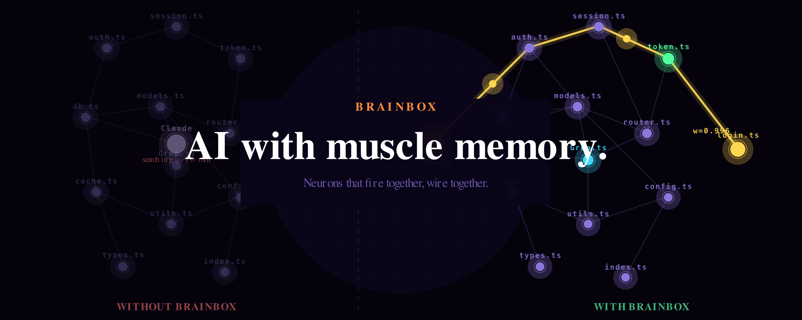

# BrainBox

<p align="center">
  
</p>

<p align="center">
  <a href="https://www.npmjs.com/package/brainbox-hebbian"></a>
  <a href="https://github.com/thebasedcapital/brainbox/stargazers"></a>
  <a href="https://github.com/thebasedcapital/brainbox/blob/main/LICENSE"></a>
</p>

Hebbian memory for AI coding agents. Learns which files you access together, which errors lead to which fixes, and which tool chains you use most — then recalls them instantly.

**Not a vector database. Not RAG. Procedural memory.**

> If BrainBox saved you tokens, [give it a star](https://github.com/thebasedcapital/brainbox) — it helps others find it.
> Built by [@thebasedcapital](https://x.com/thebasedcapital)

```
Session 1:  agent greps for auth.ts, reads it, edits it (2000 tokens)
Session 5:  agent recalls auth.ts directly, skips search (500 tokens saved)
Session 20: auth.ts is a superhighway — instant recall, zero search cost
```

## Install

```bash
npm install brainbox-hebbian
```

That's it. The postinstall script automatically:
1. Adds a `PostToolUse` hook to `~/.claude/settings.json` (learns from every file read/edit/search/command)
2. Adds a `UserPromptSubmit` hook (injects compact recall into prompts — or stays silent when it has learned you ignore it)
3. Adds a `SessionEnd` hook (scores which recalled files you actually opened/edited, compiles procedures)
4. Registers the MCP server via `claude mcp add` (8 tools: record, recall, explain, error, resolve, predict_next, stats, decay)
5. Creates the `~/.brainbox/` database directory and starts a background download of the embedding model

Hooks never download models: until the model is cached (`brainbox models pull`), recall runs lexical-only.

BrainBox learns passively from your next Claude Code session. No configuration needed.

## What's new in 0.2

Every change below was driven by a recent paper or project and measured with the new offline replay eval (see [Evaluation](#evaluation)).

- **Ranking rebuilt on evidence.** ACT-R base-level activation ([arXiv:2505.05083](https://arxiv.org/abs/2505.05083)) replaces fixed decay as the recency/frequency signal; Base3-style recurrence + popularity candidates ([2506.12764](https://arxiv.org/abs/2506.12764), [2502.04910](https://arxiv.org/abs/2502.04910)); channels are fused by weighted reciprocal rank with weights fitted on held-out-repo dev data. Directional STDP synapses; longest-suffix n-gram tool prediction.
- **Hybrid code search.** cAST-style AST chunking ([2506.15655](https://arxiv.org/abs/2506.15655)), SQLite FTS5 BM25 + `sqlite-vec` KNN fused with RRF (k=60), incremental by content hash. Default embedding model is now `jina-embeddings-v2-base-code` (q8, 768d): Recall@5 0.867 vs 0.667 for MiniLM on a 30-query code-search set.
- **Learned injection policy.** A contextual UCB1 bandit picks SILENT / TOP1 / TOP3 / TOP5 per context, rewarded by files you actually open or edit minus injected-token cost ([MemCon 2607.13591](https://arxiv.org/abs/2607.13591)). Every recall is logged with the synapse that produced it, so ignored recalls weaken only that edge ([MemTrace 2605.28732](https://arxiv.org/abs/2605.28732)). Injection is a compact `path:start-end — why` list ([FastContext 2606.14066](https://arxiv.org/abs/2606.14066)); deleted files are never injected.
- **Structural code graph.** Tree-sitter import / call / inheritance edges for TS/TSX/JS, Python, Rust, Swift, Go (tsconfig `paths`/`extends`, Go modules), seeded as weak priors (≤ 0.35) that learned co-access outranks; `bootstrap --imports --since <rev>` is incremental.
- **Procedural playbook.** Deterministic mining of *failed command → edits → passing rerun* and multi-session command workflows, with helpful/harmful counters and automatic deprecation ([ACE 2510.04618](https://arxiv.org/abs/2510.04618), [Mem^p 2508.06433](https://arxiv.org/abs/2508.06433)). Injected as quoted data, never as instructions.
- **Provenance** via the new `brainbox_explain` MCP tool: why a file was recalled, the edge that produced it, and its hit/ignore history.
- **Fixes:** builds on Node 22–26 (better-sqlite3 v13), hooks written in Claude Code's nested settings format, hook DB lock wait capped at 100 ms, procedure compile 470× faster on large histories.

### What does NOT happen automatically

The **macOS daemon** (system-wide FSEvents file watcher) is completely separate and opt-in:

```bash
# Only if you want BrainBox to learn from VS Code, Xcode, vim, shell, etc.
brainbox daemon install   # installs LaunchAgent, starts watching
brainbox daemon status    # check if running
brainbox daemon uninstall # remove completely
```

The daemon watches file changes across all your editors — not just Claude Code. It requires explicit opt-in because it registers a LaunchAgent and monitors your configured project directories.

### Uninstall

```bash
brainbox uninstall  # removes hooks + MCP server, preserves database
```

### Seed from git history (recommended)

Kill cold start by bootstrapping from your existing git history:

```bash
brainbox bootstrap --repo /path/to/project --imports
```

This seeds the neural network from git commit co-changes and import graphs so BrainBox starts with knowledge instead of from zero.

## How It Works

BrainBox implements neuroscience-inspired learning:

- **Neurons** — files, tools, and errors you interact with
- **Synapses** — connections formed when things are accessed together ("neurons that fire together wire together")
- **Myelination** — frequently-used paths get faster (like muscle memory)
- **Spreading activation** — recalling one file activates related files
- **Decay** — unused connections weaken naturally, keeping the network clean

<details>
<summary><strong>Hebbian Learning in Action</strong> (click to play)</summary>

https://github.com/thebasedcapital/brainbox/raw/main/assets/brainbox-animation.mp4

</details>

<details>
<summary><strong>Spreading Activation</strong> — recalling one file activates related files through synaptic connections</summary>

https://github.com/thebasedcapital/brainbox/raw/main/assets/brainbox-spreading.mp4

</details>

<details>
<summary><strong>Superhighway Formation</strong> — frequently-used pathways become instant-recall superhighways</summary>

https://github.com/thebasedcapital/brainbox/raw/main/assets/brainbox-superhighway.mp4

</details>

<details>
<summary><strong>Error-Fix Immune System</strong> — remembers which files fixed which errors</summary>

https://github.com/thebasedcapital/brainbox/raw/main/assets/brainbox-immune.mp4

</details>

## Other Integrations

### MCP Server (any agent)

If you're not using Claude Code, you can run the MCP server standalone:

```bash
# 8 tools: record, recall (detail: compact|full), explain, error, resolve, predict_next, stats, decay
npx tsx node_modules/brainbox-hebbian/src/mcp.ts
```

### Kilo / OpenCode (native plugin)

Add to `~/.config/kilo/config.json`:

```json
{
  "plugin": ["node_modules/brainbox-hebbian/src/kilo-plugin.ts"]
}
```

### OpenClaw (NeuroVault)

BrainBox can be deployed as an OpenClaw memory slot plugin. See [NeuroVault](https://github.com/thebasedcapital/neurovault) for the reference implementation.

| Aspect | Claude Code | OpenClaw |
|---|---|---|
| Tool names | PascalCase (`Read`) | Lowercase (`read`) |
| Context injection | `UserPromptSubmit` hook | `before_agent_start` lifecycle |
| Learning trigger | `PostToolUse` hook | `after_tool_call` lifecycle |
| Embeddings | jina-embeddings-v2-base-code (configurable) | Keyword-only (lower confidence gate) |

## CLI

```bash
brainbox recall "authentication login"
brainbox record src/auth.ts --query "authentication"
brainbox stats                 # includes stale-embedding counts + re-index commands
brainbox error "TypeError: cannot read 'token'"
brainbox predict Read
brainbox bootstrap --repo . --imports [--since <git-rev>]   # git history + tree-sitter code graph
brainbox extract-snippets [--force] [--no-embed]           # AST chunks → FTS5 + sqlite-vec
brainbox embed [--force]       # embed neurons with the active model
brainbox models pull|status    # fetch / inspect the embedding model
brainbox procedures [list|compile|show <id>|deprecate <id>]
brainbox sleep                 # consolidation + procedure compilation
brainbox eval --source nebius|omp [...]                   # offline replay evaluation
brainbox hubs | stale | projects | sessions | streaks | graph | highways | decay
```

## Configuration

| Variable | Purpose | Default |
|---|---|---|
| `BRAINBOX_DB` | SQLite path | `~/.brainbox/brainbox.db` |
| `BRAINBOX_DB_TIMEOUT_MS` | SQLite busy timeout | `5000` (hooks use `100`) |
| `BRAINBOX_EMBED_MODEL` | `minilm` \| `jina-code` \| `gemma` \| `gemma-q4` | `jina-code` |
| `BRAINBOX_MODEL_CACHE` | Model cache directory | Transformers.js default |
| `BRAINBOX_EMBEDDINGS` | `off` disables embeddings entirely | on |
| `BRAINBOX_POLICY` | `off` disables the learned injection policy (always TOP5) | on |
| `BRAINBOX_SESSION_ID` | Override session id for CLI/adapters | derived |
| `BRAINBOX_HOOK` | Set by hook entrypoints: local-only models, 1.2 s embedding deadline | unset |

Gemma profiles are subject to the [Gemma Terms of Use](https://ai.google.dev/gemma/terms).

## Evaluation

`brainbox eval` replays real coding-agent trajectories in chronological order: each task is evaluated on a fresh in-memory DB trained only on *earlier* tasks from the same repo, and all systems rank the same candidate set. Probes: **P1** files edited / read for the task (query = task text), **P2** next file (step by step), **P3** next tool (top 3). Baselines: recency, frequency, BM25, EdgeBank, random. Paired trajectory-cluster bootstrap 95% CIs.

```bash
npm run eval -- --source nebius --repos 5 --max-tasks-per-repo 20 --split test --embeddings off --engine new
npm run eval -- --source omp    --repos 5 --max-tasks-per-repo 20 --embeddings off --engine old   # v0.1 engine (needs a worktree, see src/eval)
```

MRR (P3: MRR@3), embeddings off. Ranking weights were fit only on the **dev** repos (sqlglot, dvc, streamlink); **nebius test** = 40 held-out tasks from different repos (Pillow, conan). **omp** = 97 local agent sessions across 5 projects (not used for fitting).

| Probe | nebius test: v0.1 | v0.2 | best baseline | omp: v0.1 | v0.2 | best baseline |
|---|---:|---:|---:|---:|---:|---:|
| P1 edited files | .307 | **.307** | .216 BM25 | .737 | .703 | **.791 frequency** |
| P1 read files | .191 | **.267** | .206 BM25 | .372 | **.555** | .547 BM25 |
| P2 next file | .223 | .409 | **.430 recency** (Δ CI −.049…+.003) | .634 | **.702** | .701 recency (tie) |
| P3 next tool | .479 | **.767** | .748 frequency (Δ +.019, CI +.012…+.027) | .257 | **.686** | .662 recency (Δ CI +.010…+.036) |

v0.1 lost badly to plain recency on next-file prediction (nebius test Δ −0.207, CI −0.312…−0.118); v0.2 is statistically tied with it. Tool prediction now beats every baseline significantly, and read-file recall leads on both sources. Known gap: on local sessions, edit frequency alone still beats BrainBox for *edited* files (Δ −.089, CI −.185…0). The fitted weights keep strong lexical, Hebbian and snippet channels (weight 4 each) so an explicit query (`recall "auth login"`) outranks recently/frequently touched unrelated files — fitting those to zero scored higher on dev but made recall query-blind.

## Key Features

### Hebbian Learning
Files accessed together form synapses. Access `auth.ts` then `session.ts` 10 times and BrainBox learns they're related — recalling one activates the other.

### Error-Fix Immune System
When you fix a bug, BrainBox remembers which files fixed which errors. Next time a similar error appears, it suggests the fix files immediately.

### Tool Sequence Prediction
After 20 Grep-Read-Edit chains, BrainBox predicts you'll Read after Grep and pre-loads likely files.

### SNAP Plasticity
Strong synapses resist further strengthening (like real neural synapses). Prevents any single connection from dominating the network.

### Anti-Recall Escalation
Files recalled but never opened get progressively stronger decay. Consecutive ignores escalate: 1st = 10%, 2nd = 19%, 3rd = 27%. Opening the file resets the streak.

### Hub Detection & Staleness Alerts
Identify the most-connected neurons in your network and detect decaying superhighways before they fade.

### Project Tagging
Auto-tag file neurons by project. Recall scoped to current project reduces cross-project noise.

## Architecture

```
src/
  hebbian.ts       # Engine: record, recall (rank fusion), STDP, n-gram tool prediction, decay, anti-recall
  db.ts            # SQLite schema + migrations
  policy.ts        # Recall event log + contextual UCB1 injection policy
  adapter.ts       # Shared recall/injection orchestration for all hosts
  snippets.ts      # AST chunking, FTS5 + sqlite-vec hybrid search
  embeddings.ts    # Embedding model profiles, hook-safe loading
  codegraph.ts     # Tree-sitter import/call/inherit graph
  procedures.ts    # Procedural playbook mining + matching
  bootstrap.ts     # Git history / code graph / session seeding
  installer.ts     # Hooks + MCP registration, model prefetch
  mcp.ts           # MCP server (8 tools)
  hook.ts          # PostToolUse + SessionEnd hook
  prompt-hook.ts   # UserPromptSubmit hook
  kilo-plugin.ts   # Kilo/OpenCode native plugin
  daemon.ts        # FSEvents file watcher (macOS, opt-in)
  cli.ts           # CLI
  eval/            # Offline trajectory replay evaluation
  testkit.ts       # Test harness; test.ts + tests/*.test.ts
```

## Algorithm Details

| Component | Mechanism (defaults in `DEFAULT_ENGINE_OPTIONS`) |
|-----------|-----------|
| Synapse formation | Sequential window (25 items), positional decay; directional STDP (later→earlier edge × 0.5) |
| Strengthening | SNAP sigmoid plasticity (midpoint 0.5, steepness 8); BCM myelination, 0.95 ceiling |
| Recency / frequency | ACT-R base level `B = ln Σ (Δt_h)^-0.5` over the last 50 accesses |
| File ranking | Weighted reciprocal-rank fusion: lexical (FTS5, scaled by verbatim query-term coverage) 4, Hebbian evidence 4, code snippets 4, frequency 2, recency 1, base level 0.5, recurrence 0.2; session recency 30 when the query matches the current session |
| Spreading | 3-hop BFS, fan-out cap 10, fan effect 1/sqrt(degree) |
| Tool prediction | Longest-suffix n-grams (n ≤ 3, min support 4) fused with frequency (0.5) |
| Code search | AST chunks; FTS5 BM25 + sqlite-vec KNN, RRF k=60 |
| Structural priors | import 0.2, call ≤ 0.35, inherit 0.3; never override learned co-access |
| Injection policy | UCB1 over SILENT/TOP1/TOP3/TOP5; reward = rank-weighted opens/edits − 2 per 1k tokens |
| Anti-recall | Ignored recalls weaken only the producing edge; `1 - (1 - 0.1)^streak`, floor 0.1 |
| Error learning | 2x boosted learning rate; error→fix procedures from failed→edited→passing reruns |

Full details in [WHITEPAPER.md](./WHITEPAPER.md).

## Tests

```bash
npm test                      # 147 tests
npx tsx src/test.ts "Ranking" # filter by suite/test name
```

## Requirements

- Node.js 22+
- macOS or Linux (FSEvents daemon is macOS-only, everything else is cross-platform)

## License

MIT
