**Bhavesh B**, independent researcher · bhaveshb@proton.me · ORCID [0009-0007-9680-3842](https://orcid.org/0009-0007-9680-3842)

**Version 2** · DOI [10.5281/zenodo.23250505](https://doi.org/10.5281/zenodo.23250505). This version supersedes the February 2026 version; all versions share the concept DOI [10.5281/zenodo.18664906](https://doi.org/10.5281/zenodo.18664906), and Section 7 lists what changed. Code: [thebasedcapital/brainbox](https://github.com/thebasedcapital/brainbox) on GitHub (MIT). Text: CC BY 4.0.

**Keywords:** coding agents · behavioral memory · Hebbian learning · spreading activation · tool prediction · rank fusion · offline replay

# 1. Introduction

A developer who comes back to a codebase knows where things are. They open the authentication module without searching for it, run the tests the way they always do, and remember that a particular import error is fixed in the session layer. A coding agent remembers none of this. Each session begins with an empty context, and the agent rediscovers the repository through searches whose answers it has, in a sense, found many times before.

That access patterns can be learned is an old idea in systems. Fido, a predictive cache described in 1991, learned which database objects tended to be requested together and fetched them before they were asked for [@fido1991]. The same idea now runs through caches and prefetchers at every level of the machine. BrainBox moves it one level higher, into the working life of a coding agent. It watches the tools the agent calls and the files it reads and edits. It learns which resources go together, and it offers the most likely ones before the agent goes looking.

The learning rule is Hebbian in spirit: resources used together become associated [@hebb1949]. Recall spreads activation outward from whatever the query matches [@collins1975]. Nothing is written into the model's weights. Memory is a small SQLite database on the developer's machine, updated by hooks and queried without a single language-model call.

The first version of this paper argued for BrainBox mainly through estimated token savings in synthetic sessions and a small, hand-labeled recall benchmark. Those estimates assumed the very thing worth testing, namely that the recalled files are the ones the agent needed. This version asks a narrower question that can actually be answered. Given everything an agent has done in a repository so far, how well does its memory predict what it will touch next?

We answer it by replaying recorded agent trajectories in order, letting memory learn only from the past, and comparing it with the simple heuristics that any memory must beat. The answer is clearest for tools: BrainBox predicts the next tool better than every baseline on both cohorts. For files the picture is mixed. BrainBox matches the best heuristic, but on a user's own projects plain frequency is the better guess for the next edit. And most of what an agent touches in a new task it has never touched before, which no memory of past behavior can predict.

This paper makes three contributions:

1. **A complete local system** that combines directed co-access learning, spreading activation with fan damping, query-aware rank fusion and suffix-based tool prediction. Around these sit code search, a learned injection policy and mined error-fix procedures (Section 3).
2. **A replay protocol without foresight.** Before each task it freezes the set of resources memory could know about, and it reports how many targets fall inside that set as well as how well they are ranked (Section 4).
3. **Measured results** against five heuristic baselines with paired confidence intervals, including the comparisons BrainBox loses (Section 5), and an account of what changed since the first version (Section 7).

# 2. Related work

**Memory for language-model agents.** Recent agent memories organize experience in several ways. A-MEM keeps it as linked notes, SYNAPSE as episodic and semantic stores joined by spreading activation, and MAGMA as several relation graphs at once [@amem2025; @synapse2026; @magma2026]. Most store what the agent has read or been told, mediated by a language model. BrainBox stores what the agent has *done*, through deterministic updates from tool events, and it is meant to sit beside such systems rather than replace them. We do not compare against them experimentally here.

**Procedures and tool experience.** ToolMem learns what tools are capable of. MACLA builds hierarchical procedural memory through Bayesian selection and contrastive refinement, and NEMORI distills which experiences deserve to be kept [@toolmem2025; @macla2025; @nemori2025]. All three use a model to abstract experience. BrainBox's procedure miner instead recognizes one fixed shape: a failing command, the edits that followed, and a passing rerun. That makes it easy to audit, but it cannot generalize beyond what it has seen.

**Association and time.** Hebb's postulate and its many computational descendants [@hebb1949; @safa2024] motivate learning from co-occurrence. ACT-R's base-level activation [@actr2025] motivates weighting each resource by how often and how recently it was used. Research on temporal graphs offers a useful corrective: simple recency and popularity heuristics are hard to beat at predicting the next interaction [@heuristics2025], which is why they serve as our baselines. Cortex caches knowledge for language-model retrieval [@cortex2025], and like Fido it treats prediction as a way to avoid repeating work.

**Retrieval.** Reciprocal-rank fusion combines rankers whose raw scores cannot be compared [@rrf2009], and cAST shows that chunking code along its syntax tree improves code retrieval [@cast2025]. BrainBox uses both as components. Neither is a contribution of this paper.

# 3. BrainBox

## 3.1 Overview

BrainBox runs as a set of hooks around an agent (Figure 1). After each tool call it records which tool ran and which files it touched. Before each prompt it ranks candidate files, decides how many to show the agent, if any, and injects a compact list. At the end of a session it scores what became of those suggestions (opened, edited or ignored) and compiles repeated fixes into procedures. The same functions are available to any agent through an MCP server with eight tools: `record`, `recall`, `explain`, `error`, `resolve`, `predict_next`, `stats` and `decay`.

{width=100%}

Memory is a graph of resources (files, tools and errors) joined by directed, weighted associations. Each resource keeps its access count, its last access time, an activation level, context gathered from the queries in which it appeared, and a bounded reinforcement value. Each association keeps its weight, its co-access count and its timestamps. Logs of accesses, recall decisions and their outcomes sit alongside, as do code snippets and procedures when those features are in use.

## 3.2 Learning from co-access

When the agent touches a resource, BrainBox looks back over the last 25 distinct resources and strengthens the association from each of them to the new one. Let $w_{uv}$ be the weight from an earlier resource $u$ to the current resource $v$. The step is

$$
\delta_{uv}=\eta\,p\,h\,d\,g(w_{uv}),\qquad g(w)=\frac{1}{1+e^{8(w-0.5)}},
$$

and the weight moves toward 1:

$$
w'_{uv}=\min\{1,\;w_{uv}+\delta_{uv}(1-w_{uv})\}.
$$

Four factors shape the step:

- **Recency in the window.** The position factor $p\in(0,1]$ favors resources touched just before the current one.
- **Hubs.** The hub factor $h$ halves the step when either endpoint already has more than 20 associations, so ubiquitous files such as package manifests do not absorb all the credit.
- **Direction.** The earlier-to-later association receives the full step ($d=1$) and the reverse association half of it ($d=0.5$). If the agent habitually opens a test after its source file, memory learns *source → test* more strongly than *test → source*.
- **Errors.** Errors double the learning rate from its ordinary value of $\eta=0.1$, because an error and the edits that resolve it are rarer and more informative than ordinary reads.

Because the gate $g$ falls as $w$ rises, new associations grow quickly and strong ones slowly (Figure 2). With one co-access per session at the ordinary rate, a pair of files reaches 0.10 after the first session, 0.38 after five and 0.66 after twenty. A new association enters with the step computed from zero. Tagging and maintenance can adjust stored weights in other ways, so the equation describes the ordinary path rather than every transition.

{width=100%}

Each resource also carries a reinforcement value $m$, which rises with use and saturates below 0.95:

$$
\Delta m=0.02\left(1-\frac{m}{0.95}\right)\max\left\{\frac{1}{\sqrt{\max(n,1)}},\;0.1\right\},
$$

where $n$ is the resource's access count. When maintenance runs, activation, reinforcement and association weight decay multiplicatively by daily factors of 0.85, 0.995 and 0.98, and weak associations are pruned.

## 3.3 Recall

Recall turns a query, usually the user's prompt, into a ranked list of files. Candidates arrive through several channels (Table 1). Each channel produces its own ranking, and reciprocal-rank fusion combines them.

The associative channel spreads activation outward from the files the query matches directly (Figure 3). Activation travels at most three hops and follows at most ten edges out of each node, passing from $u$ to $v$ as

$$
a_v=a_u\,w_{uv}\,\bigl(1+\min\{m_v,m_{\max}\}\bigr)\,\bigl[\max\{1,\min(\deg u,\,D_{\max})\}\bigr]^{-1/2}.
$$

The last factor is the fan effect: a file connected to everything says little about any one of its neighbors. Only strong edges and confident targets pass, and a target reached along several paths keeps its best score rather than their sum. Because reinforcement can raise individual factors, it is the hop limit, not attenuation alone, that bounds the spread.

{width=100%}

Two further channels capture time. Base-level activation, adapted from ACT-R, scores each resource by the recency and frequency of its last 50 accesses:

$$
B_i(t)=\ln\sum_{j}\max\Bigl\{\tfrac{t-t_{ij}}{1\,\mathrm{h}},\;\tfrac{1}{60}\Bigr\}^{-0.5}.
$$

Recurrence proposes resources associated with what was touched recently. Plain recency and frequency are channels as well, so BrainBox can always fall back on the heuristics it has to beat.

For candidate $i$ ranked $r_c(i)$ by channel $c$, the fused score is

$$
S(i\mid q)=\sum_{c}\frac{\lambda_c\,\gamma_c(i,q)}{20+r_c(i)}.
$$

| Channel | Weight $\lambda_c$ | Notes |
|:---------------------------------------|-------------:|:------------------------------------------------------------|
| Lexical | 4 | Scaled by the share of query terms matched |
| Associative (spreading activation) | 4 | Seeded by query matches, not by popularity |
| Code snippets | 4 | Needs a snippet index |
| Frequency | 2 | Historical access count |
| Recency | 1 | Rises to 30 when the query refers to current-session work |
| Base-level activation | 0.5 | ACT-R recency and frequency |
| Recurrence | 0.2 | Associates of recently touched resources |

: Fusion channels and their default weights.

The lexical factor $\gamma$ is the fraction of distinct query terms a file matches, so a file that matches one incidental word cannot outrank one that matches the whole request; for the other channels $\gamma=1$. The constant 20 is smaller than the conventional 60 [@rrf2009], which sharpens differences among the top few ranks. The normalized score that BrainBox reports as *confidence* is a ranking score, not a calibrated probability. The weights were chosen on development repositories that the evaluation never scores, together with checks that explicit queries still override habits. No tuning log was kept, so they are reasonable defaults rather than an estimated optimum.

## 3.4 Predicting the next tool

Tool calls are more regular than file accesses: an agent tends to search, read, edit and test in recurring orders. BrainBox predicts the next tool from the longest recent suffix, up to three tools, that it has seen at least four times. It backs off to shorter suffixes and then to direct associations. The sequence ranking is fused with tool frequency (weights 1 and 0.5), and the three most likely tools are returned.

## 3.5 Beyond ranking

**Code search.** Tree-sitter parses source files into syntax-aware chunks and extracts import, call and inheritance edges. The edges enter the graph as weak priors that real co-access can override. Snippets are retrieved by fusing FTS5 BM25 with optional local embeddings. The default model is a quantized Jina code model with 768 dimensions that runs on the CPU. Hooks never download models, and when embeddings are unavailable, search falls back to keywords.

**Deciding how much to show.** Showing the agent a long list costs context, and showing it nothing forgoes the benefit. A contextual policy therefore chooses among SILENT, TOP1, TOP3 and TOP5. Its context is the recall confidence band, the kind of query, how familiar the project is and how far the session has progressed. After a short warm-up it selects the arm with the highest upper confidence bound,

$$
U(a)=\overline{R}_a+0.15\sqrt{\frac{2\ln N}{N_a}},
$$

with reward

$$
R=\sum_{i\,\in\,\text{used}}\frac{v_i}{r_i}\;-\;2\,\frac{\widehat{T}}{1000}.
$$

Here $v_i$ is 1 for a suggestion the agent later read and 1.5 for one it edited, $r_i$ is the suggestion's rank, and $\widehat{T}$ estimates the injected tokens as characters divided by four. Silence earns zero. When a suggestion is ignored, only the association that produced it is weakened.

**Procedures.** At the end of a session, a deterministic miner looks for a failing command followed by edits and then a passing rerun of a similar command. It also looks for workflows repeated across at least three sessions. Error-fix procedures are keyed by a fingerprint of the error. Every procedure keeps counts of helpful and harmful outcomes and is retired when it keeps failing. Procedures are shown to the agent as quoted observations from past sessions, never as instructions.

These three components are part of the system but outside the evaluation in Section 5, which measures ranking alone.

## 3.6 A note on names

BrainBox borrows its vocabulary from neuroscience (neurons, synapses, myelination, spike timing) because the analogy is a good guide to the design. The mechanisms themselves are engineering heuristics. The reinforcement value saturates but has nothing like the sliding threshold of BCM theory. The directional factor reflects the order of events rather than spike timing, and *myelination* is the name of a database column. The first version of this paper described its dynamics as matching models from neuroscience. We no longer make that claim.

# 4. Evaluation design

## 4.1 The question

We measure prediction. Given memory built from an agent's earlier work in a repository, how highly does BrainBox rank what the agent touches next? Good prediction is necessary for a useful memory but not sufficient. A memory that ranks well might still be ignored, injected at the wrong moment, or cost more context than it saves. Those questions need live experiments, which Section 6 discusses.

## 4.2 Data

**Public trajectories.** The public cohort comes from Nebius's release of OpenHands trajectories on SWE-rebench tasks [@nebius2025], 67,074 trajectories in our catalog snapshot. We keep the earliest attempt for each issue and rank repositories by their number of distinct issues. The five largest then alternate between development (sqlglot, dvc and streamlink) and test (Pillow and conan). The test cohort holds 40 tasks, at most 20 per repository, ordered by pull-request number as a proxy for time. Thirty of the 40 trajectories did not resolve their issue. We score what the agent did, not whether it succeeded.

**Local sessions.** The second cohort is 97 sessions of the author's own agent work, drawn from at most five projects out of 715 session files spanning nine. These sessions are private and still growing, so we report them as a secondary, descriptive cohort rather than an independently auditable benchmark.

## 4.3 Replay without foresight

Each repository gets a fresh in-memory database, and its tasks are replayed in order. Before task $t$ begins, the evaluator freezes the candidate universe $U_t$, the files and tools seen in earlier tasks. Every probe ranks only members of $U_t$. Within a task, each event is predicted before it is recorded, and resources first seen during the task join the universe only for later tasks. The simulated clock advances one second per event, so time-based features see the order of events but not the days between sessions.

We ask four questions of each task:

- **P1-edit.** From the task description alone, which files will the agent edit?
- **P1-read.** From the same description, which files will it read?
- **P2.** At each step, which file will it touch next?
- **P3.** At each step, which tool will it call next?

Gold answers come from the trajectory itself. A probe's eligible gold is $G'_t=G_t\cap U_t$, and probes with no eligible gold count toward coverage but not ranking. The results therefore measure retrieval among things memory *could* know, the natural ceiling for any history-based method. They do not measure localization over an entire repository.

## 4.4 Metrics, baselines and uncertainty

We report mean reciprocal rank (MRR) truncated at ten for files and at three for tools. For P1, a task's reciprocal rank uses its first relevant file. P2 and P3 average over individual predictions, so long trajectories weigh more. Each comparison is paired: BrainBox and the baseline rank the same targets, and a 95% interval for their difference comes from 1,000 bootstrap resamples of whole trajectories (seed 42). Resampling whole trajectories respects the correlation within a task, though not between tasks that share a repository's growing history.

The baselines see the same history and the same candidate universe:

- **Recency:** most recently touched first.
- **Frequency:** most often touched first.
- **BM25:** lexical match between the query and each file's accumulated path and context ($k_1=1.2$, $b=0.75$).
- **Co-session:** files that shared past sessions with the current task's files, in the spirit of EdgeBank.
- **Random:** a seeded shuffle.

For each probe the tables show the strongest baseline, chosen after the fact. Appendix A lists all five.

## 4.5 Scope

All runs use keyword retrieval with embeddings off. The replay exercises recording, error association, recall and tool prediction. It does not build code indexes, run the injection policy, apply procedures or put a live agent in the loop. The artifacts contain token figures for injected path lists, but these are estimates and we do not report them as savings.

# 5. Results

## 5.1 Coverage

The first result is a limit (Table 2). Only 17% of public next-file targets, and 42% of local ones, had been touched in an earlier task. For tools the figures are 96% and 73%. Within these histories, agents working on a new task mostly touch files they have never touched before, and those files are invisible to any memory of past behavior. The rankings that follow are therefore conditional. They describe how well BrainBox orders the part of the future it could have known.

| Cohort | Probe | Gold targets | Eligible | Probes | Scored |
|:--|:--|--:|--:|--:|--:|
| Public | P1-edit | 298 | 28 | 40 | 16 |
| | P1-read | 374 | 92 | 40 | 30 |
| | P2 next file | 1,303 | 221 | 1,303 | 221 |
| | P3 next tool | 2,727 | 2,625 | 2,727 | 2,625 |
| Local | P1-edit | 693 | 121 | 97 | 38 |
| | P1-read | 980 | 343 | 97 | 57 |
| | P2 next file | 5,885 | 2,490 | 5,885 | 2,490 |
| | P3 next tool | 9,663 | 7,083 | 9,663 | 7,083 |

: Coverage. *Eligible* targets were seen in an earlier task. For P1, gold targets are summed over tasks; for P2 and P3 they are individual predictions.

## 5.2 Public trajectories

| Probe | Version 1 | Version 2 | Baseline | Difference | 95% CI | *n* |
|:--|--:|--:|:--|--:|:--|--:|
| P1-edit | 0.307 | 0.307 | BM25 0.216 | +0.092 | [−0.018, +0.224] | 16 |
| P1-read | 0.191 | 0.267 | BM25 0.206 | +0.061 | [−0.038, +0.165] | 30 |
| P2 next file | 0.223 | 0.409 | Recency 0.430 | −0.021 | [−0.049, +0.003] | 30 |
| P3 next tool | 0.479 | 0.767 | Frequency 0.748 | **+0.019** | **[+0.012, +0.027]** | 38 |

: Public cohort, conditional MRR (MRR@3 for tools). *Baseline* is the strongest of the five for each probe, and *Difference* is version 2 minus that baseline. *n* counts trajectories with at least one scored target. Version 1 was replayed on the same cohort and settings; version-to-version changes are descriptive, with no paired interval.

Tool prediction is the clear result. BrainBox improves on the strongest baseline, frequency, by 0.019 with an interval that excludes zero, and on the version-1 predictor by 0.29 (from 0.479 to 0.767). Retrieval from the task description also leads the best baseline, BM25, by 0.06 to 0.09, but with only 16 and 30 scored tasks the intervals are wide and include zero. Next-file prediction improved substantially on version 1 (from 0.223 to 0.409) and is now level with recency. Edited-file retrieval is unchanged at 0.307.

## 5.3 Local sessions

| Probe | Version 2 | Baseline | Difference | 95% CI | *n* |
|:--|--:|:--|--:|:--|--:|
| P1-edit | 0.703 | Frequency 0.791 | −0.089 | [−0.185, 0.000] | 38 |
| P1-read | 0.555 | BM25 0.547 | +0.008 | [−0.101, +0.123] | 57 |
| P2 next file | 0.702 | Recency 0.701 | +0.001 | [−0.003, +0.006] | 64 |
| P3 next tool | 0.686 | Recency 0.662 | **+0.024** | **[+0.010, +0.036]** | 85 |

: Local cohort, conditional MRR (MRR@3 for tools). *n* counts sessions with at least one scored target.

The private cohort repeats the tool result: BrainBox beats recency by 0.024, with an interval clear of zero. It also contains the clearest loss. For the files the agent went on to edit, ranking by plain frequency scores 0.791 against BrainBox's 0.703, and the interval reaches zero only at its upper edge. In a user's own long-running projects, the files edited most often are a strong guess for the next edit, and BrainBox's query-aware fusion gives some of that away. The read-file and next-file differences are within ±0.01 of the best baseline and indistinguishable from it. Figure 4 shows both cohorts together.

{width=100%}

# 6. Discussion

## 6.1 Tools are habits; files are tasks

The results draw a consistent line between two kinds of behavior. Tool use is habitual: an agent's sequences of calls recur from task to task, so its own history predicts them well. That is where BrainBox's sequence model, which conditions on up to three previous tools, earns a dependable advantage over simple frequency and recency. Files are tied to tasks. Most files a task needs are new to memory, and among the familiar ones, recency and frequency already capture much of what history can tell. BrainBox's associative and query-aware channels bring it level with those heuristics, and ahead of lexical search when given a task description, though not by a significant margin. They do not leave the heuristics behind.

The local edited-file loss suggests a concrete improvement. In long-running personal projects, a file's long-run edit frequency deserves more weight than the current fusion gives it. Adapting channel weights per project, for example with the same bandit machinery that already controls injection, is the natural next step. It is untested here.

## 6.2 Limitations

**Prediction is not productivity.** The trajectories are fixed, so the replay cannot show that suggestions would be read, that searches would be skipped, or that patches would improve. Better next-tool prediction may reflect the conventions of one agent framework more than transferable knowledge.

**Coverage bounds the scores.** Conditioning on previously seen resources keeps the protocol free of leakage, but it leaves new files unscored. An unconditional measure, reported separately for tasks dominated by known and by new files, would complete the picture. The small number of scored P1 tasks also limits precision.

**Selection and tuning.** The public test set covers two repositories and is ordered by pull-request number, a proxy for time. The local cohort is private and evolving. Ranking defaults were developed on separate repositories, but results were inspected during engineering, so the protocol is not preregistered.

**No ablations.** Several ranking mechanisms changed together between versions, and the available runs do not isolate their contributions. A small embedding comparison mentioned in the project documentation is omitted because its query set and raw outcomes are not part of this evidence.

**Feedback is heuristic.** Confidence is not calibrated, opens and edits are imperfect evidence that a suggestion helped, and the injection policy carries no regret guarantee in a shifting environment.

**Security and privacy.** Memory records commands, paths and excerpts, so the local database should be treated as sensitive. A poisoned repository could manufacture misleading associations or procedures. Presenting procedures as quoted observations limits the damage but does not authenticate them, and permission to act must remain outside the memory.

**Scale and provenance.** Each update and traversal is bounded, at most $s(10+10^2+10^3)$ edge visits for $s$ seeds before filtering. Consolidation keeps the access log to the last 30 days and 5,000 rows, and decay prunes weak associations, but we have not measured how the database grows over months of use. Latency was not re-measured for this version. The current result artifacts record their settings but not a source commit or input manifest (Section 8).

## 6.3 Next experiments

1. A live study with memory switched on and off at random, measuring task success, tool calls, tokens counted by a real tokenizer, and wall-clock time.
2. Unconditional retrieval scores, with separate reports for tasks dominated by known and by new files.
3. Channel ablations and adaptive channel weights per project.
4. Evaluation of code search and embeddings on a released query set.
5. Source-pinned reruns with frozen input manifests.

# 7. What changed since version 1

| Version 1 | Version 2 |
|:-----------------------------------------------------|:-----------------------------------------------------------------|
| Gross token savings of 8.9% in production and about 40% in simulation | Withdrawn as evidence. Both were estimates built on assumed search costs. Replaced by measured prediction quality. |
| 67% top-1 recall on 15 hand-labeled queries, five times a baseline | Superseded by chronological replay of 137 recorded trajectories against five baselines with paired intervals. |
| Learning dynamics "match" BCM, Ebbinghaus and spreading-activation models | Reframed as engineering heuristics inspired by those models (Section 3.6). |
| First deployed system of its kind; existing memories confined to declarative knowledge | Removed. Positioning is now descriptive (Section 2). |
| Superiority over Mem0, Zep, Letta, LangMem and others | Removed. No head-to-head experiments were run. |
| Recall in under 5 ms | Not re-measured for version 2, so not claimed. |
| Recall by spreading activation behind confidence gates | Rank fusion of seven channels, ACT-R base level, directional learning, suffix-based tool prediction, code search, a learned injection policy and mined procedures. |

: Claims in the first version and their status in this one.

The first version was right about the opportunity and generous about the evidence. This version keeps the system, which has grown considerably, and narrows the claims to what the replay can support.

# 8. Reproducibility

The methods described here were checked against source revision `0edc2ed`. The numbers come from four result files under `eval-results/`:

| Cohort | Version 2 | Version 1 (commit `9750d2f`) |
|:--|:--|:--|
| Public | `2026-10-08T18-01-31-878Z` | `2026-10-08T17-37-06-513Z` |
| Local | `2026-10-08T18-06-22-676Z` | `2026-10-08T17-42-39-240Z` |

: Result files behind Tables 2–4 and Appendix A.

The files record their settings but not the source commit, parser version, dataset revision or selected inputs. The link between these numbers and revision `0edc2ed` therefore rests on timing and matching settings rather than a recorded hash. Result files are not committed to the repository. The companion file `paper/evidence.json` preserves the aggregate figures used here, together with SHA-256 hashes of the originals, and contains no private session text.

The public results can be regenerated from the repository root:

```bash
npm ci --ignore-scripts && npm rebuild better-sqlite3
npm run eval -- --source nebius --repos 5 --max-tasks-per-repo 20 \
  --split test --embeddings off --engine new --seed 42 --json
```

Replacing `--engine new` with `--engine old` replays version 1, which needs a worktree of commit `9750d2f`; the command prints how to create one. The dataset is fetched and cached on first use, so future reruns can differ if the source changes. The local cohort cannot be reproduced on another machine.

# 9. Conclusion

An agent's own history is a modest but dependable signal. In BrainBox's hands it predicts the next tool better than any simple heuristic we tried, and it ranks familiar files about as well as the best of them. Most of what an agent touches in a new task lies outside that history, and on long-running personal projects, raw frequency remains a formidable guess. BrainBox makes this history cheap to keep, local to the machine and open to inspection. The next version of this paper should test whether keeping it makes agents finish real work sooner.

# Appendix A. All baselines {.unnumbered}

| Cohort | Probe | BrainBox | Recency | Frequency | BM25 | Co-session | Random |
|:--|:--|--:|--:|--:|--:|--:|--:|
| Public | P1-edit | 0.307 | 0.167 | 0.100 | 0.216 | 0.100 | 0.030 |
| | P1-read | 0.267 | 0.071 | 0.173 | 0.206 | 0.075 | 0.113 |
| | P2 next file | 0.409 | 0.430 | 0.156 | 0.254 | 0.274 | 0.035 |
| | P3 next tool | 0.767 | 0.691 | 0.748 | 0.671 | 0.743 | 0.357 |
| Local | P1-edit | 0.703 | 0.577 | 0.791 | 0.447 | 0.158 | 0.138 |
| | P1-read | 0.555 | 0.397 | 0.431 | 0.547 | 0.011 | 0.142 |
| | P2 next file | 0.702 | 0.701 | 0.587 | 0.495 | 0.485 | 0.049 |
| | P3 next tool | 0.686 | 0.662 | 0.590 | 0.595 | 0.440 | 0.161 |

: Conditional MRR for every method (MRR@3 for tools).

# Appendix B. Where each mechanism lives {.unnumbered}

| Source | Mechanisms | Exercised by the replay |
|:------------------------------------|:-------------------------------------------------|:--------------------------------|
| `src/hebbian.ts` | Co-access learning, spreading activation, base level, fusion, tool prediction | Yes, as a whole |
| `src/policy.ts` | Injection policy, outcome attribution | No |
| `src/procedures.ts` | Error-fix and workflow mining | No |
| `src/snippets.ts`, `src/codegraph.ts` | Code chunks, hybrid search, structural edges | No |
| `src/embeddings.ts` | Local embedding models | Disabled |
| `src/eval/` | Replay, probes, baselines, bootstrap | Defines the protocol |

: Source map.

# References {.unnumbered}
